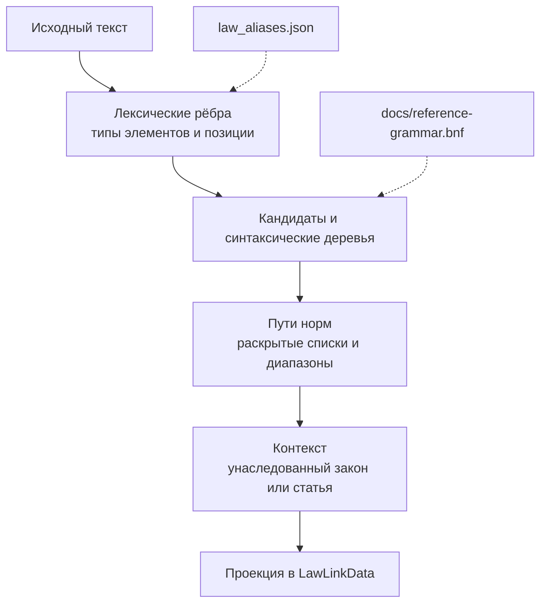
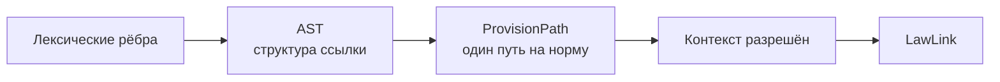
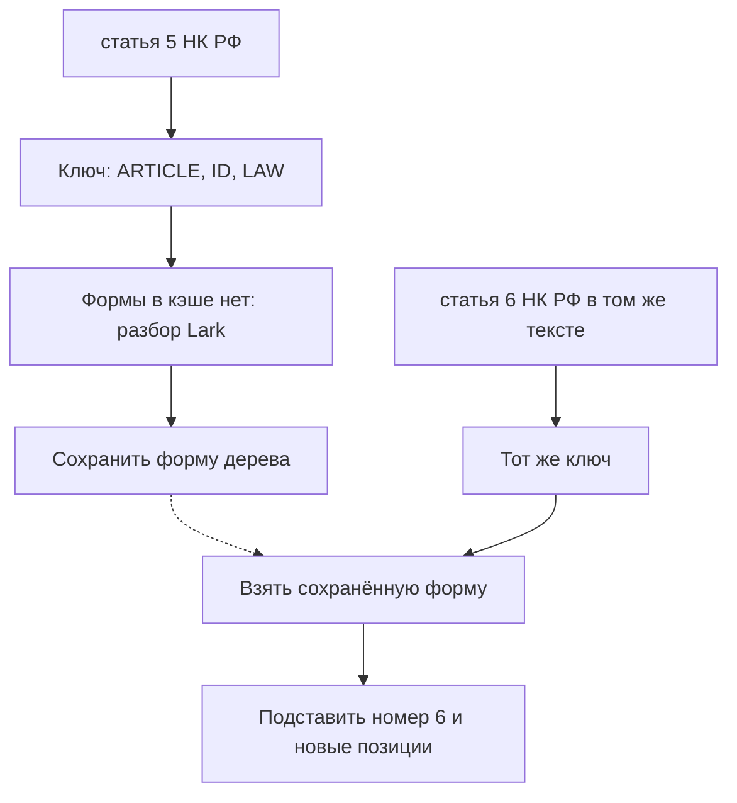

# Внутреннее устройство обработки ссылок

Этот документ описывает, как код распознаёт и интерпретирует ссылку: от разметки исходного текста до внутреннего результата. Формат API, назначение сервиса и инструкции по запуску описаны в [README.md](README.md). Термины проекта собраны в [словаре](EXPLAIN-TERMS.md).

## Жизненный цикл компонентов

В main.py модель `TextRequest` проверяет входные данные. При запуске приложения функция `lifespan` загружает `law_aliases.json` и создаёт анализатор ссылок, семантический анализатор и разрешитель контекста. Анализатор заранее строит индексы и сохраняет ограниченные LRU-кэши, поэтому эти структуры повторно используются при обработке запросов. Далее обработчик последовательно запускает стадии, описанные ниже.

## Лексический анализ: какие элементы есть в тексте

`ReferenceAnalyzer` — класс в reference_parser.py, который выполняет две стадии: распознаёт элементы ссылки и проверяет их сочетания по грамматике. Он получает исходный текст и возвращает `Analysis` с найденными фрагментами, вариантами их разбора и диагностикой. Номера уровней и связи между ними далее интерпретирует отдельный `SemanticAnalyzer`.

На лексической стадии `ReferenceAnalyzer` определяет, какие куски текста могут входить в ссылку. Например, в `пп. 1, 2 п. 3 ст. 5 НК РФ` он распознаёт маркеры подпункта, пункта и статьи, идентификаторы `1`, `2`, `3`, `5` и алиас закона `НК РФ`.

Сначала `_tokenize` разбивает строку на слова, числа и знаки препинания. Каждый элемент сохраняет начало и конец в исходной строке. Это позволяет позже связать результат с тем местом текста, откуда он был получен.

Затем `_recognize_edges` присваивает этим кускам возможные типы токенов: `ARTICLE` для маркера статьи, `ID` для номера, `AND` для союза «и», `RANGE` для разделителя диапазона. Один распознанный токен может объединять несколько исходных кусков. Например, `_tokenize` разделит `НК РФ` на `НК` и `РФ`, а `_recognize_edges` распознает всё сочетание как один токен `LAW`.

Чтобы позднее собрать последовательность токенов, программа хранит для каждого варианта ребро: запись с токеном и двумя индексами в списке исходных кусков. Первый индекс показывает, откуда читать, второй — где продолжить после этого токена. В примере `статья 5 НК РФ` куски имеют индексы `0: статья`, `1: 5`, `2: НК`, `3: РФ`. Рёбра `ARTICLE: 0 → 1`, `ID: 1 → 2` и `LAW: 2 → 4` образуют одну цепочку. Число `4` обозначает позицию после последнего куска. Эти индексы отличаются от позиций символов в строке, которые тоже сохраняются в токене.

Для распознавания слов учитываются регистр, нормализация Unicode и формы слова. Морфологический анализ с помощью `pymorphy3` помогает сопоставить склонённую форму маркера с начальной формой — например, `статьей` с `статья` — и распознавать названия законов; результаты повторяющихся проверок тоже кэшируются. Из `law_aliases.json` при запуске строится индекс алиасов: он связывает известные названия и сокращения с ID закона.

Длинное название закона иногда удаётся распознать даже с опечаткой. Это нечёткое сопоставление, которое выполняет `_fuzzy_law_edges`. Например, в ссылке `ст. 5 Федерального закона "О персональных данныз"` последняя буква в слове «данных» заменена на «з». Поиск находит название «О персональных данных» из словаря, а `_recognize_edges` связывает найденный ID со всем упоминанием федерального закона (здесь слова считаются похожими, если отличаются не больше, чем 2 буквами; 2 - просто условность, по-хорошему нужна калибровка на реальных текстах с опечатками, но такие найдены не были именно по тематике законов.)

При сравнении программа использует формы слов: исходное написание и возможные начальные формы, полученные от морфологического анализатора. Например, набор для «кодекса» включает «кодекса» и «кодекс». Совпадение по начальной форме позволяет учитывать склонение без исправления букв.

Для коротких слов алиаса предусмотрена обработка случайных разрывов. В `ст. 5 Н-К РФ` программа может соединить буквенные куски `Н` и `К`, получить `НК` и распознать сочетание как `НК РФ`. Она рассматривает склейки длиной до шести букв и вычисляет их один раз для каждой позиции текущего текста. Отдельная проверка исправляет некоторые опечатки в полных словах-маркерах: например, `пунта` можно сопоставить с `пункта`, удалив одну букву из правильного написания. Для маркера допускается не более одной вставки, удаления или замены.

После распознавания названия возможны два разных случая. В `ст. 6 рандомного кодекса` название есть, но ID в словаре для него нет: это неизвестный закон. В `ст. 6` название отсутствует: это неуказанный закон. Различие нужно следующей стадии: отсутствующий закон можно восстановить из предыдущей ссылки, а явно названный неизвестный закон нельзя подменять предыдущим.

Лексический анализ намеренно хранит несколько возможных прочтений. Например, короткий дефис может быть частью номера или разделителем диапазона. Вставной номер статьи вроде `6-1` сохраняется как единый идентификатор. ASCII-дефис между числами раскрывается как диапазон только при подтверждённом множественном маркере; `–` и `—` распознаются как разделители диапазона для поддерживаемых числовых значений. Окончательное решение о раскрытии и его границах принимает семантическая стадия. Если название сопоставляется с несколькими ID, это неоднозначный алиас.

`_CandidateLexer` выполняет техническую передачу токенов в Lark. В его названии есть слово Lexer, но он получает уже распознанную цепочку и превращает её элементы в объекты `Token`, сохраняя тип, значение и позиции. Например, тип `LAW` для `НК РФ` определяет `_recognize_edges`; `_CandidateLexer` передаёт этот готовый результат парсеру. Поэтому правила распознавания сокращений или опечаток нужно искать в `ReferenceAnalyzer`, а правила преобразования токенов для Lark — в `_CandidateLexer`.

## Поиск фрагментов и синтаксический разбор: как элементы связаны

Метод `_parse_candidates` класса `ReferenceAnalyzer` получает исходные куски текста и рёбра, построенные `_recognize_edges`. Он начинает цепочку только с распознанного маркера уровня (`ARTICLE`, `POINT` и других), затем перебирает доступные продолжения и проверяет полученные цепочки по грамматике. Парсер получает одну такую цепочку за раз. Он не выбирает начало ссылки в исходном тексте: эту работу выполняет `_parse_candidates`. {open: все еще не понятно, что такое ReferenceAnalyzer - это ли Эрли парсер, или это какой-то свой класс, неясно что он делает, что это за объект }

Например, в `Текст перед ссылкой: статья 5 НК РФ` поиск начинает цепочку с `статья`, а не со слова `Текст`. Если один кусок допускает несколько типов или разную длину токена, метод рассматривает несколько цепочек. Каждый лексический кандидат содержит возможное прочтение отдельного фрагмента, а синтаксический разбор проверяет, как такие прочтения сочетаются.

Грамматика хранится в docs/reference-grammar.bnf. Она описывает, как маркеры статьи, части, пункта, подпункта и абзаца могут сочетаться; как оформляются списки значений и диапазоны; и как несколько ветвей могут делить общую статью или название закона. Это грамматика ссылок, а не грамматика всего русского текста.

Из Lark используется парсер Earley, поскольку грамматика неоднозначна. Если один фрагмент допускает несколько синтаксических деревьев, анализатор сохраняет альтернативы разбора. Они становятся `AstNode` и `AstLeaf` — узлами и листьями AST. Листья сохраняют исходные значения и позиции, а узлы показывают отношения, заданные правилами грамматики.

Для одинаковых последовательностей типов токенов используется кэш формы разбора. В ключе находятся типы вроде `ARTICLE`, `ID`, `LAW`, но не исходные номера, написание или позиции. Поэтому одну грамматическую структуру можно применить к другой ссылке той же формы: при каждом использовании программа заново привязывает листья к текущим значениям, ID закона и позициям текста. LRU-кэш хранит до 4 096 недавних шаблонов, включая неудачные разборы. Если очередной токен доказывает, что префикс уже нельзя продолжить по грамматике, этот путь дальше не расширяется.

Результат стадии — `Analysis`: список лексических кандидатов, найденные фрагменты-кандидаты (`CandidateSpan`), возможные деревья разбора и диагностика. Некоторые фрагменты могут перекрываться: короткая ссылка бывает началом более длинной. В `/detect` используется `analyze_for_service`: он откладывает построение AST до выбора самого длинного полного кандидата для каждой начальной позиции. Полный метод `analyze` сохраняет все найденные фрагменты и остаётся доступен для подробного анализа.

## Семантический анализ: что именно означает найденная структура

`SemanticAnalyzer` в semantic_analyzer.py получает деревья разбора и определяет, на какие конкретные нормы указывает ссылка. Например, дерево для `пп. 1, 2 п. 3 ст. 5 НК РФ` содержит список двух подпунктов, связанных с одним пунктом и одной статьёй. Анализатор создаёт два результата: подпункт 1 пункта 3 статьи 5 НК РФ и подпункт 2 пункта 3 статьи 5 НК РФ. Общие родительские уровни сохраняются в обоих результатах.

Для каждой нормы создаётся путь нормы (`ProvisionPath`). В нём раздельно хранятся закон, статья, часть, пункт, подпункт, абзац, статус идентификации закона и возможные ID. Это внутреннее представление подробнее, чем итоговый формат API.

На этой стадии списки и поддерживаемые диапазоны превращаются в отдельные пути. Для `пп. 1, 2 п. 3 ст. 5 НК РФ` получаются два `ProvisionPath`, различающиеся только номером подпункта. Если внутри одной ветви перечислены значения на двух уровнях, анализатор строит все их сочетания. Например, два подпункта и два пункта дают четыре пути: каждый подпункт в каждом пункте. Значения из разных ветвей не смешиваются; общий закон в конце сгруппированной ссылки применяется к её ветвям.

Раскрыть диапазон означает заменить запись его границ отдельными номерами. Например, `статьи 5–7 НК РФ` даёт три пути — для статей `5`, `6` и `7`. Метод `_selector_values` в `semantic_analyzer.py` допускает не более 1 000 номеров в одном диапазоне, считая обе границы. Так, `1–1000` проходит эту проверку, а `1–1001` вызывает диагностику `range_too_large`. Такой диапазон не сокращается до первых 1 000 номеров: ссылка отклоняется на семантической стадии. Ограничение проверяется при раскрытии каждого диапазона; оно не задаёт предел для числа явно перечисленных номеров или числа ссылок в документе.

Диапазон раскрывается только для поддерживаемого разделителя, подходящих концов и допустимого контекста. Например, ASCII-дефис между номерами расширяется в числовой диапазон при явном множественном маркере, тогда как `6-1` после единственного `статья` остаётся номером статьи. Обратные, чрезмерно длинные и неподдерживаемые диапазоны приводят к диагностике вместо догадки.

Если несколько синтаксических деревьев дают одинаковые пути норм, анализатор сохраняет один общий семантический результат. Если одна интерпретация однозначно уточняет другую, он может выбрать более полную. Когда альтернативы приводят к несовместимым значениям, фрагмент остаётся неразрешённым и отмечается диагностикой.

На этой стадии также учитываются перекрытия фрагментов. Анализатор выбирает наиболее длинную поддержанную интерпретацию для одной позиции и отбрасывает перекрывающиеся результаты, чтобы части одной ссылки не превратились в дублирующие самостоятельные ссылки.

## Разрешение контекста: восстановление пропущенного закона или статьи

После семантического анализа разрешитель контекста `ContextualResolver` в contextual_resolver.py проходит ссылки слева направо. Он помнит последний явно распознанный закон. Если следующая ссылка не называет закон, этот закон можно унаследовать. Например, в предложении «Согласно статье 5 НК РФ, … согласно статье 6 …» вторая ссылка может получить закон из первой.

Разрешитель также обрабатывает самоотсылки и анафорические ссылки, например «настоящей статьи» и «указанного закона». Если название закона отсутствует или заменено такой отсылкой, используется последний явно упомянутый закон. Явно написанное название сохраняется, даже когда его ID не найден в словаре.

Для восстановления номера в выражении «указанной статьи» разрешитель просматривает предыдущие статьи от ближайшей к самой далёкой. Он проверяет ID законов, чтобы не взять статью из другого кодекса. Например, если текущая ссылка относится к НК РФ, ближайшая предыдущая статья УК РФ не подходит; поиск продолжается до статьи, закон которой совместим с НК РФ. Для неоднозначных названий достаточно хотя бы одного общего ID. Если текущий закон известен, а ID закона предыдущей статьи неизвестен, такая статья тоже не подходит. Если у текущей ссылки нет ни одного известного ID закона, проверка не ограничивает выбор предыдущей статьи по закону. Если подходящей статьи нет, номер остаётся неопределённым. Именно номер статьи восстанавливается с этой проверкой совместимости.

## Проекция результата в `LawLink`

Функция `map_semantic_analysis` в law_link_mapper.py переносит значения из каждого `ProvisionPath` в `LawLinkData`. Обработчик в `main.py` затем создаёт из этих записей модели `LawLink`. Схема внешнего ответа описана в README.md.

Внутренний путь хранит больше уровней, чем `LawLink`. Если в пути одновременно есть часть и пункт, поле `point_article` получает пункт, а номер части пропускается. Если есть только часть, её номер записывается в это поле. Для абзаца отдельного поля нет. Поэтому пути «абзац 1 статьи 5 НК РФ» и «абзац 2 статьи 5 НК РФ» после преобразования дадут одинаковые записи: в обеих останутся тот же закон и статья, а номер абзаца исчезнет. Преобразователь добавит диагностику об исключённом уровне; обработчик `/detect` возвращает только ссылки, без этой диагностики.

Одинаковые записи сохраняются: `map_semantic_analysis` добавляет результат для каждого пути и не удаляет повторы. Если одна и та же успешно разобранная ссылка встречается в двух разных местах документа, обе находки также сохраняются в ответе. Это не конфликт: внутренние результаты хранят позиции находок, а выходная схема позиций не содержит. Сведение одинаковых интерпретаций альтернативных деревьев на семантической стадии относится к разбору одной находки; оно не объединяет все одинаковые ссылки документа.

Если алиас соответствует нескольким законам, внутренний путь сохраняет все возможные ID. Для `LawLinkData` выбирается минимальный ID, а преобразователь добавляет диагностику `ambiguous_law_identity_resolved_to_minimum`.

## Кэширование

Рассмотрим текст: `Применяется статья 5 НК РФ. Позднее применяется статья 6 НК РФ.` Даже если кэш разбора был пуст перед этим запросом, первую цепочку типов `ARTICLE, ID, LAW` программа передаст в Lark через `_parse_shape`. После разбора она сохранит структуру дерева под ключом `("ARTICLE", "ID", "LAW")`.

При второй ссылке ключ тот же. `_parse_shape` найдёт сохранённую структуру и повторно запускать Lark для этой формы не потребуется. `_materialize_shape` подставит в неё значения второй ссылки: номер `6`, её название закона и её позиции в строке. Поэтому результат второй ссылки сохраняет номер `6`, хотя форма дерева была вычислена при разборе статьи `5`. Аналогично повторно используются формы промежуточных цепочек, проверяемых при поиске кандидатов, и результаты неудачных проверок.

Кэшируется и морфологическая обработка. Например, `_word_forms("статья")` обращается к `pymorphy3` при первом вычислении и сохраняет формы этого слова. Когда в том же тексте снова встретится точно такое же написание `статья`, метод вернёт сохранённый набор. Другая форма, например `статьи`, имеет собственную запись кэша. При построении словаря часть слов уже могла попасть в кэш ещё до обработки текста.

Для нечёткого поиска `_fuzzy_form_alias_candidates` сохраняет набор возможных алиасов по трём признакам: число кусков названия, позиция проверяемого куска внутри названия и его формы. Если в тексте дважды встречается одно длинное название с одинаковой опечаткой, повторная проверка соответствующих слов получает предварительный набор из кэша и не обходит BK-tree заново. Окончательная проверка названия целиком и создание токена с текущими позициями всё равно выполняются.

Внутри одного вызова `_recognize_edges` есть и локальное хранилище `dirty_alias_ends`: если несколько проверок алиасов начинаются в одной позиции, возможные склейки коротких буквенных кусков вычисляются один раз. После завершения этого вызова локальное хранилище исчезает.

Отдельно `analyze_for_service` сокращает работу без кэша: сначала выбирает самый длинный полный фрагмент для каждой начальной позиции и только затем строит для выбранных фрагментов AST. Поэтому деревья промежуточных коротких кандидатов не создаются.